# pyBEM: How-To Guide & Multi-Zone Examples

Welcome to the `how-to_examples` directory for **pyBEM (V0.5.2-alpha)**. This guide details the workflow for creating, exporting, and verifying multi-zone Boundary Element Method (BEM) acoustic models using `PrePoMax` and `pyBEM`. Furthermore, results with ready to run models for several examples are explained and supplied.

---

- [pyBEM: How-To Guide \& Multi-Zone Examples](#pybem-how-to-guide--multi-zone-examples)
  - [1. BEM Meshing \& Modelling Rules](#1-bem-meshing--modelling-rules)
  - [2. PrePoMax Workflow \& `*.inp` Export](#2-prepomax-workflow--inp-export)
    - [2.1 Mesh Generation \& Normal Verification](#21-mesh-generation--normal-verification)
    - [2.2 Acoustic Material Properties](#22-acoustic-material-properties)
    - [2.3 Surface Definitions \& TIED Pairs](#23-surface-definitions--tied-pairs)
    - [2.4 Amplitude Curves, Step Definition \& Damping](#24-amplitude-curves-step-definition--damping)
    - [2.5 Acoustic Boundary Conditions \& Export](#25-acoustic-boundary-conditions--export)
  - [3. EXAMPLES](#3-examples)
    - [3.1 `1m_pipe`: Straight 1m Pipe (Interior) Analysis Suite](#31-1m_pipe-straight-1m-pipe-interior-analysis-suite)
      - [3.1.1 CASE 1: PRES @ INLET \& Rigid OUTLET](#311-case-1-pres--inlet--rigid-outlet)
      - [3.1.2 CASE 2: PRES @ INLET \& PRES @ OUTLET](#312-case-2-pres--inlet--pres--outlet)
      - [3.1.3 CASE 3: PRES @ INLET \& IMPE ($Z = \\rho c$) @ OUTLET](#313-case-3-pres--inlet--impe-z--rho-c--outlet)
      - [3.1.4 CASE 4: VELO @ INLET \& Rigid OUTLET](#314-case-4-velo--inlet--rigid-outlet)
      - [3.1.5 CASE 5: \[ VELO + IMPE ($Z = \\rho c$) \] @ INLET \& Rigid OUTLET](#315-case-5--velo--impe-z--rho-c---inlet--rigid-outlet)
      - [3.1.6 CASE 6: VELO @ INLET \& IMPE ($Z = \\rho c$) @ OUTLET](#316-case-6-velo--inlet--impe-z--rho-c--outlet)
      - [3.1.7 `1m_pipe`: Comparison code\_aster (FEM acoustics) vs pyBEM](#317-1m_pipe-comparison-code_aster-fem-acoustics-vs-pybem)
      - [3.1.8 `1m_pipe`: Preliminary Conclusions](#318-1m_pipe-preliminary-conclusions)
    - [3.2 `int_ext_boxes`: Simultaneous Interior \& Exterior Acoustic Analysis](#32-int_ext_boxes-simultaneous-interior--exterior-acoustic-analysis)
      - [3.2.1 Outlet Flange with Sharp (90deg) Corners](#321-outlet-flange-with-sharp-90deg-corners)
      - [3.2.2 Chamfered Outlet (Smoother Corners)](#322-chamfered-outlet-smoother-corners)
      - [3.2.3 All TRIAs, Chamfered Outlet](#323-all-trias-chamfered-outlet)
      - [3.2.4 `int_ext_boxes`: Preliminary Conclusions](#324-int_ext_boxes-preliminary-conclusions)

---
---

> [Back to MAIN page](../README.md)

---

## 1. BEM Meshing & Modelling Rules

To ensure mathematical formulation and convergence during the BEM assembly and solving stages, all input BEM meshes must strictly comply with the following architectural rules:

1. **Watertight Domains:** Every BEM acoustic zone must be a completely closed, watertight surface (shell) mesh. MICS meshes do not need to comply with this rule, but be at least half the BEM element size away from the boundary.
2. **Normal Orientation (CRITICAL):** All BEM element normals **MUST point AWAY from the acoustic domain** (pointing outwards for interior acoustic domains or inwards for exterior ones).
3. **Unique Entity IDs:** Node and element IDs exported from PrePoMax must be unique. Sequential gaps ("jumps") in ID numbers are fully supported for both BEM & MICS meshes, this happens when re-meshing a part.
4. **Zone Declaration via Materials:** Acoustic zones are declared by assigning a matching **Material Name** to BEM elements and (optional) MICS elements for a given zone.
5. **Element Types:** Supported shell elements from `PrePoMax` include 3-node linear triangles [`S3` (BEM) & `M3D3` (MICS)] and 4-node linear quadrilaterals [`S4` (BEM) & `M3D4` (MICS)].

---

## 2. PrePoMax Workflow & `*.inp` Export

`PrePoMax` is used as the primary pre-processor for mesh generation, surface grouping, boundary condition assignments and analysis setup. Because PrePoMax is designed primarily for structural FEA, some custom keywords (commands) for acoustics are injected via the PrePoMax **Keywords Editor**.

### 2.1 Mesh Generation & Normal Verification

1. Mesh `BEM` domain surfaces using linear shell elements (`S3` & `S4`).

    ```ini
    **
    ** Elements ++++++++++++++++++++++++++++++++++++++++++++++++
    **
    *Element, Type=S3, Elset=bem_z1
    1, 69, 68, 67
    ...
    *Element, Type=S4, Elset=bem_z1
    2, 6, 5, 67, 68
    ...
    **
    ```

2. Optional `MICS` visualisation meshes (used for ParaView contours) should be assigned the same BEM zone material name, and use shell elements (`M3D3` or `M3D4`). In PrePoMax edit a 'part' to access element types via a dropdown.

    ```ini
    *Element, Type=M3D4, Elset=mics_z1
    510, 517, 507, 536, 608
    *Element, Type=M3D3, Elset=mics_z1
    570, 530, 531, 629
    ```

3. Use PrePoMax visual tools to **verify** that all shell **surface normals point AWAY** from the acoustic fluid domain. Flipping normals can be done in the 'Geometry' module: select a part -> `Geometry (menu) -> CAD Part -> Flip Face Normal`. This tool will also show colour coded the normals orientation. The latter can also be displayed via `View -> Color Annotations -> Face Orientations`; both in the 'Geometry' & 'FE Model' tabs.
\
\
pyBEM will automatically identify 'normals' consistency per zone at pre-processing, and assign either an **interior or exterior** zone analysis depending on the direction of the normals. It will also trigger an error and stop a job if cracks, holes, T-junctions and zero domain volume are detected in the input mesh on each BEM zone.
\
\
Below is shown a typical `.log` file entry from pyBEM on acoustic zones:

    ```log
        ==============================
        *** INPUT MESH DIAGNOSTICS ***
        ==============================
        Found a total of ( 2 ) Acoustic ZONES as follows:

    --> ZONE: [ 'z1_Air' ]
        BEM Surface Area:              ( 170712 L^2 )
        CoG of BEM zone:               [ 249.99, 0.01, 0.02 ] L
        Max Element Aspect Ratio:      ( 1.75 )
        Element Edge Size (approx):    ( 31.38 L )
        Element CoG Distance (approx): ( 15.04 L )
        Suggested Max Freq:            ( 2281.5 Hz )
        Closed (+) Volume detected:    ( 3.79026e+06 L^3 )
        -> Normals point OUTWARDS ==> Assuming INTERIOR Analysis

    --> ZONE: [ 'z2_Air' ]
        BEM Surface Area:              ( 170564 L^2 )
        CoG of BEM zone:               [ 749.98, -0.04, -0.00 ] L
        Max Element Aspect Ratio:      ( 1.52 )
        Element Edge Size (approx):    ( 33.27 L )
        Element CoG Distance (approx): ( 16.72 L )
        Suggested Max Freq:            ( 2051.9 Hz )
        Closed (+) Volume detected:    ( 3.7748e+06 L^3 )
        -> Normals point OUTWARDS ==> Assuming INTERIOR Analysis

    --> BC-PROCESSING: BC resolution complete ==> ( 24 ) elements have active BCs.
    ```

### 2.2 Acoustic Material Properties

Define fluid properties in PrePoMax using density ($\rho$) and Bulk Modulus ($K$):

- **Density ($\rho$):** create a material in the UI with only density; e.g., $1.21 \times 10^{-12} \text{ tonne/mm}^3$
- **Bulk Modulus ($K$)**, add to materials via the keywords editor: e.g. $0.14239 \text{ MPa}$ (yielding speed of sound $c = \sqrt{K / \rho} = 343,041 \text{ mm/s}$)

    > Material names are also used to define different acoustic zones (BEM & MICS) via element sets:

    ```ini
    **
    ** Materials +++++++++++++++++++++++++++++++++++++++++++++++
    **
    *Material, Name=z1_Air
    *Density
    1.21E-12
    *Acoustic Medium
    0.1424,
    ** Bulk modulus (K): c = sqrt(K/Rho)
    *Material, Name=z2_Air
    *Density
    1.21E-12
    *Acoustic Medium
    0.1424,
    ** Bulk modulus (K): c = sqrt(K/Rho)
    **
    ** Sections ++++++++++++++++++++++++++++++++++++++++++++++++
    **
    *Shell section, Elset=z1_bem, Material=z1_Air, Offset=0
    1
    *Shell section, Elset=z2_bem, Material=z2_Air, Offset=0
    1
    *Shell section, Elset=z1_mics, Material=z1_Air, Offset=0
    1
    *Shell section, Elset=z2_mics, Material=z2_Air, Offset=0
    1
    ```

### 2.3 Surface Definitions & TIED Pairs

- Group BEM or MICS elements into named **Surfaces** (e.g., `INLET`, `OUTLET`, `SILENCER_WALLS`). These are then used for BCs application in the input deck, plus power calculations and plots generated (by default) at the end of a pyBEM job.
- For multi-zone models, define **TIED Pairs** between Master and Slave surfaces. PrePoMax will generate the surfaces automatically when selecting them during the `*Tie` setup in the UI (from tree: `Constraints -> Tie`).
\
\
`pyBEM` enforces **interface continuity** (conservation of energy) via a Dual-Lagrange collocation solver. It handles (non-conforming) **dissimilar meshes** at the interface, and **auto-selects** the best slave-master (input) surface pairing for better accuracy across the tied pair. Therefore, there is no need from the user to think which one should be the master or slave, the solver will make that decision at pre-processing. Good UX for faster turn around of models.
\
\
The `Position tolerance` value (length units) is used to find what element pairs (intersections) will be declared at pre-processing. This helps to overcome small gaps/overlaps or slightly uneven meshes.

    ```ini
    **
    ** Constraints +++++++++++++++++++++++++++++++++++++++++++++
    **
    *Tie, Name=Tie-1, Position tolerance=1
    Internal_Selection-1_Tie-1_Slave, Internal_Selection-1_Tie-1_Master
    **
    ```

  > [!NOTE]
  > By default, `pyBEM` will calculate all acoustic powers (mag or "Apparent", real or "Active", imag or "Reactive") and additional surface metrics going through each of the surfaces defined in the input file. It also generates a figure with plots for SWL - dB (Sound Power Level). look out for the `CSV` & `PNG` files at the end of a job.

### 2.4 Amplitude Curves, Step Definition & Damping

1. Define (optional) frequency / amplitude curves (`*Amplitude`) to be applied to boundary conditions (separate real and imaginary entries) and/or damping. PrePoMax has an easy to use, `Amplitudes` section in the model tree.
2. Set up a direct frequency analysis (`Steady State Dynamics Step`) defining start frequency, end frequency, and total number of frequencies to solve.
3. Inside the Step definition specify acoustic Damping Ratio ($\zeta$) if applicable (note that Loss Factor $\eta = 2\zeta$). In PrePoMax select: `Damping type = Constant; Damping ratio = 0.01` ; e.g. for 1% damping.

### 2.5 Acoustic Boundary Conditions & Export

1. Open the PrePoMax **Keywords Editor** prior to export to insert commands in order to apply acoustic boundary conditions (BC) on **surface names** within the STEP definition:

    - **PRES:** Pressure boundary condition ($P = \bar{p}$).
    - **VELO:** Element normal velocity ($v_n = \bar{v}$).
    - **IMPE:** Acoustic surface impedance; e.g. ($Z = \rho c$).
    - **VELO + IMPE:** Combined normal velocity with surface impedance.

    > Example STEP definition showing the format for damping and BCs:

    ```ini
    ** [i] lines starting with more than one '*' are comments, 
    **     handy to switch on/off BCs on model variants.
    *Step
    *Steady state dynamics
    20, 1200, 119, 1
    ** 1st freq, last freq, number of freqs; e.g. from 20Hz -> 1200Hz; delta_Freq = 10Hz
    **
    ** Damping +++++++++++++++++++++++++++++++++++++++++++++++++
    ** [i] Ignore the word 'Modal', it's just how PrePoMax writes it out
    *Modal damping
    1, 1000000, 0.01
    **
    ** Boundary conditions +++++++++++++++++++++++++++++++++++++
    **   Load case=1 ==> real | Load case=2 ==> imaginary
    *Boundary, op=New
    ** Ac. pressure - on a Surface - DoF = 8
    *Boundary, Load case=1
    inlet, 8, 8, 2E-11
    **
    ** Acoustic Impedance - on a Surface
    ** *Impedance, Load case=1
    ** inlet, 4.1503e-7
    ** outlet, 4.1503e-7
    **
    **
    ** Loads +++++++++++++++++++++++++++++++++++++++++++++++++++
    **
    *Cload, op=New
    *Dload, op=New
    ** Name: Vels: Deactivated
    ** Acoustic Normal Vels - on a Surface - DoF = 8
    ** *Cload, Load case=1
    ** inlet, 8, 5e-5
    **
    *End step
    ```

    For **frequency dependant inputs** use existing Amplitude table names like this:

    ```ini
    *Modal damping, Amplitude=<table_name>
    ...
    *Boundary, Load case=1, Amplitude=<table_name_1>
    ...
    *Impedance, Load case=2, Amplitude=<table_name_2>
    ...
    *Cload, Load case=1, Amplitude=<table_name_3>
    ...
    ```

2. Export the setup from `PrePoMax` via: `File -> Export -> Calculix *.inp` input file ready for `pyBEM` to run.

---

> [!TIP]
> The fastest way to get started with a **`PrePoMax` template for `pyBEM`** is to copy one of the small `*.pmx` files provided in the examples sub-folders. These already contain the **hand edits** in the keywords editor for materials and BCs.
> \
> In PrePoMax ('Geometry' tab), after importing new CAD parts, if you select an old 'part' and a new one in the tree, right-click and do 'Swap Part Geometries'. The template part names remain, but contain the new CAD. Then the complete meshing and setup should rebuild automatically for similar setups.

---

## 3. EXAMPLES

The sub-folders under `how-to_examples/` contain complete and ready to run input decks (`*.inp`), `*.log` files, and power plots for various acoustic setups, as solved in pyBEM. Furthermore, PrePoMax (`*.pmx`, V2.6.0) and ParaView (`*.pvsm`, V5.13) state (session) files, are supplied when applicable. PV results are not included in the repo, but most models in each folder are fast to run via the batch script `run_suite.py`.

```text
how-to_examples/
├── README.md
├── assets/
└── 1m_pipe/
    ├── 01_zones_pipe_1m.inp
    ├── 01_tri_zones_pipe_1m.inp
    ├── ...
    ├── ...
    ├── 06_zones_pipe_1m.inp
    └── 06_tri_zones_pipe_1m.inp
├── int_ext_boxes/
```

> [!TIP]
> You can use the script `run_suite.py` supplied in the `pyBEM_code` folder, to batch solve all *.inp files found in a given directory.

---

### 3.1 `1m_pipe`: Straight 1m Pipe (Interior) Analysis Suite

> [!NOTE]
> $L = 1.0 \times 10^{3}\text{ mm}$ ; $c = 343 \times 10^{3}\text{ mm/s}$ ; $\rho = 1.21 \times 10^{-12}\text{ tonne/mm}^3$ ; Damping Factor = 1%

This suite demonstrates **6 boundary condition (BC) variants** for a $1\text{m}$ circular straight duct, across a frequency sweep $20\text{Hz} - 1200\text{Hz}$. These 6 cases were solved for **2 different meshes**: QUADs and all TRIAs (about 2 x DoF vs QUADs mesh) to illustrate further BEM acoustics with a standard collocation method at element centroids (DoF), and help to understand their corresponding pros and cons for each application and/or model size (BEM element count).

> **Meshes**: figure shows details of the meshes and ties for the 2 models

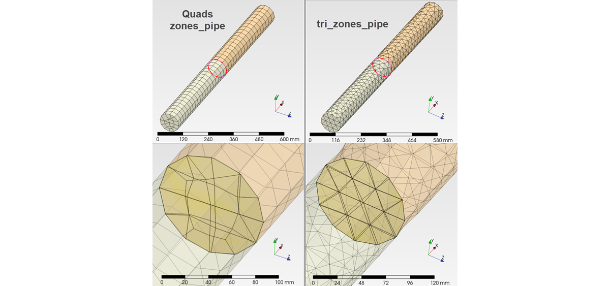

In acoustics a simple straight pipe with BC variants at the inlet & outlet surfaces can demonstrate key properties, tricks for fast post-processing and understanding of results that will later on appear with complex 3D interior acoustics systems; e.g. intake & exhaust systems. They'll help to allow for **fast & informed decision making**, which I believe is the primary objective of any CAE work for research or in-production.

We can easily model half-wave pipes (open or closed both ends) and quarter-wave pipes (open one end, rigid the other end), and compare to simple hand calculations on resonant frequency peaks. Furthermore, it is a simple and fast model to test a new acoustics solver on some basic principals, and compare to other solvers.

The `*.inp` input files supplied in this folder solve at every 10Hz for fast initial turnaround to start getting a grasp with pyBEM. Nevertheless, the result graphs shown for each case were generated at every 1Hz, to catch properly all frequency peaks with a small 1% of damping. Furthermore, this finer frequency stepping allows for fair comparisons to other codes, as a too coarse freq solve may miss peaks slightly differently. These pipe models comprise **2 interior zones & 1 TIED pair**; this is to show the multi-zone capability.

#### 3.1.1 CASE 1: PRES @ INLET & Rigid OUTLET

- **Boundary Conditions:**
  - **Inlet:** Sound Pressure ($P = 2\times 10^{-11}\text{ MPa}$)
  - **Outlet:** Rigid Boundary (Default: $v_n = 0\text{ mm/s}$)

- **Acoustic Behaviour:** Classic quarter-wave resonator: open one end & closed the other end. Resonant peaks occur at odd harmonics:

$$f_n = \frac{(2n - 1) c}{4L} = 85.75, 257.25, 428.75, 600.25\dots \text{ Hz}$$

> **SWL (dB)**: automatic power outputs in pyBEM

Note how frequency peaks match hand calculation for a quarter-wave pipe.

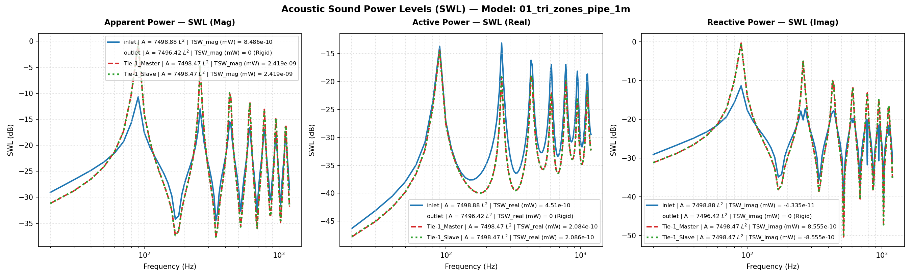

> **SPL (dB) & Power (mW)**: Abaqus vs pyBEM

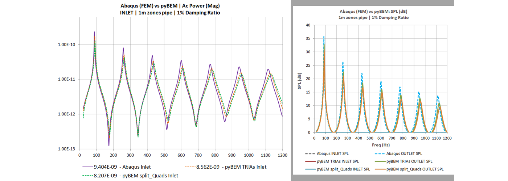

> **Power (mW) at TIED pair**: Abaqus vs pyBEM.

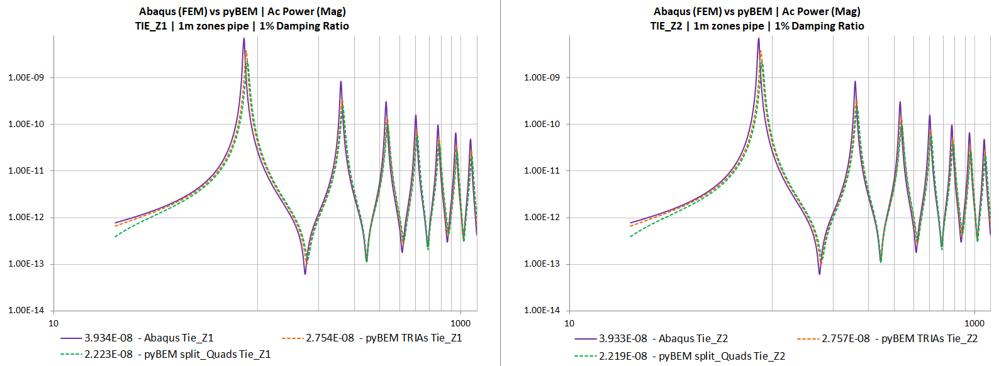

> **SPL (dB) Contours**: pyBEM results in ParaView

Figure shows SPL distribution at 260Hz.

The slight differences on contours and SPL graph peaks are expected at every 10Hz with different mesh densities and single zone vs 2 zones for the purposes of this example. It is common in-production to compare designs, meshes for a coarse freq stepping first, then solve finally approved models, at every 1Hz; like it was done in graphs above.

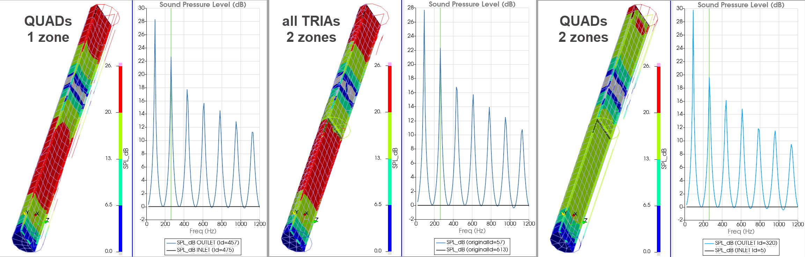

---

#### 3.1.2 CASE 2: PRES @ INLET & PRES @ OUTLET

- **Boundary Conditions:**
  - **Inlet:** Sound Pressure ($P = 2\times 10^{-11}\text{ MPa}$)
  - **Outlet:** Sound Pressure ($P = 2\times 10^{-11}\text{ MPa}$)

- **Acoustic Behaviour:** Half-wave pipe *open* at both ends. Resonant peaks occur at integer half-wave harmonics:

$$f_n = \frac{n \cdot c}{2L} = 171.5, 343.0, 514.5, 686.0\dots \text{ Hz}$$

> **SWL (dB)**: automatic power outputs in pyBEM

Note how frequency peaks match hand calculation for a half-wave pipe. In this case, both ends have constant pressure, and it is not trivial to capture clearly all resonant peaks at inlet or outlet. See power curves for the tie surfaces in the middle of the pipe, showing more peaks.

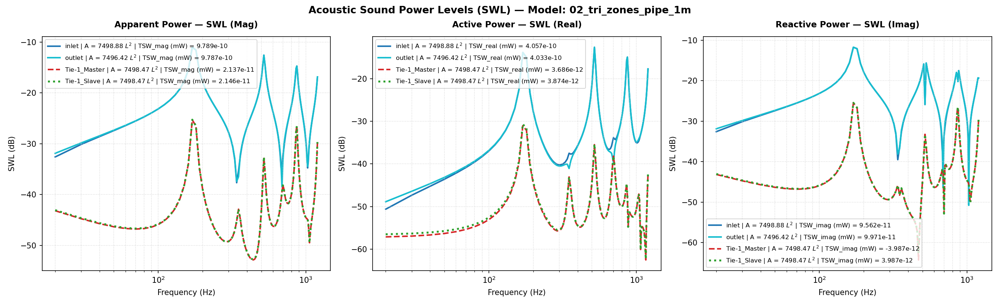

> **Power (mW)**: Abaqus vs pyBEM

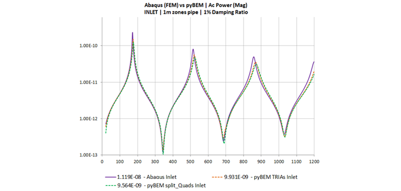

> **SPL (dB) Contours**: pyBEM results in ParaView

Figure shows SPL distribution at 1200Hz.

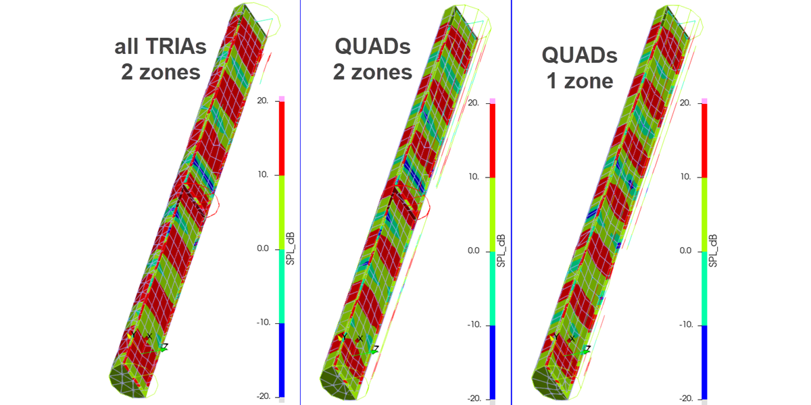

---

#### 3.1.3 CASE 3: PRES @ INLET & IMPE ($Z = \rho c$) @ OUTLET

- **Boundary Conditions:**
  - **Inlet:** Sound Pressure ($P = 2\times 10^{-11}\text{ MPa}$)
  - **Outlet:** Anechoic Impedance ($Z = \rho \cdot c$)

- **Acoustic Behaviour:** Non-reflecting anechoic termination. Acoustic energy exits without internal reflections, yielding a frequency response with no standing wave peaks.

> **SWL (dB)**: automatic power outputs in pyBEM

Note the wiggles in pyBEM are noise, inherent in BEM, unless high mesh density is used. However, note the small range on the scales used. Normally the noise should be small enough compared to relevant sound level results; i.e. application dependant.

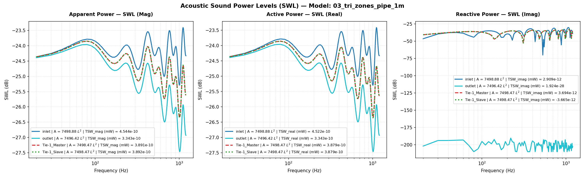

> **Power (mW)**: Abaqus vs pyBEM

We can observe the effect mentioned above in the comparison: all TRIAs (higher DoF in matrix solve, less noisy) vs QUADs models.

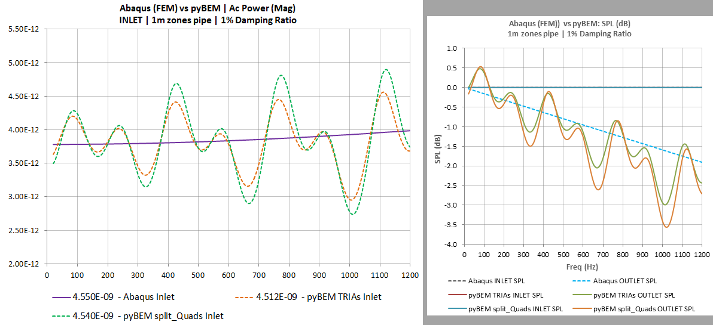

> **SPL (dB) Contours**: pyBEM results in ParaView

Figure shows SPL distribution at 1200Hz. Note the small scales range used for this specific case.

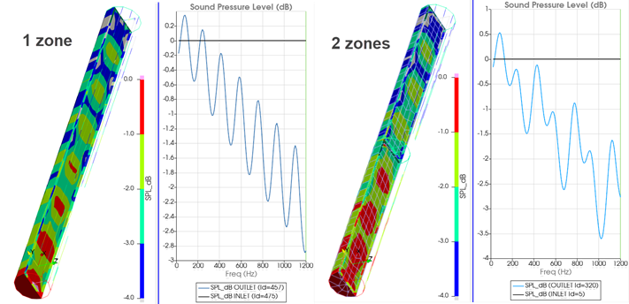

---

#### 3.1.4 CASE 4: VELO @ INLET & Rigid OUTLET

- **Boundary Conditions:**
  - **Inlet:** Normal Velocity ($v_n = 5\times 10^{-5}\text{ mm/s}$) | Rigid piston
  - **Outlet:** Rigid Boundary (Default: $v_n = 0\text{ mm/s}$)

- **Acoustic Behaviour:** Half-wave pipe *closed* at both ends. Resonant peaks occur at integer half-wave harmonics:

$$f_n = \frac{n \cdot c}{2L} = 171.5, 343.0, 514.5, 686.0\dots \text{ Hz}$$

> **SWL (dB)**: automatic power outputs in pyBEM

Note how frequency peaks match hand calculation for a half-wave pipe.

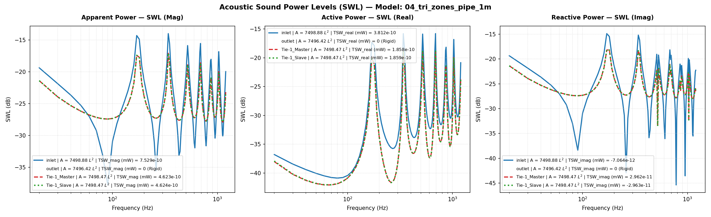

> **Power (mW)**: Abaqus vs pyBEM

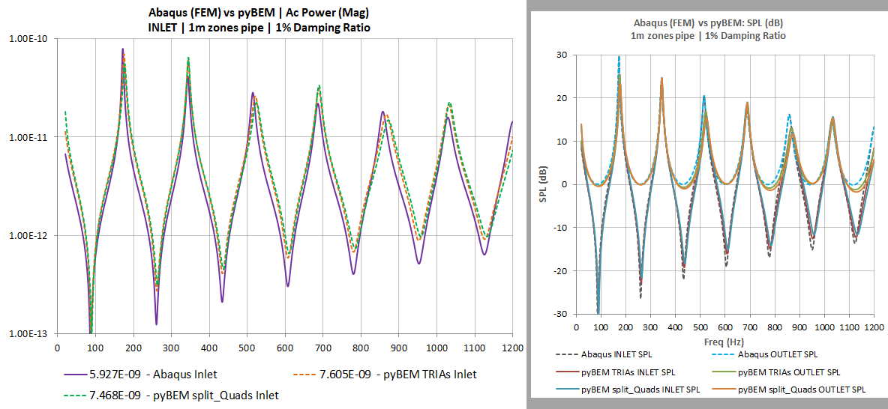

> **SPL (dB) Contours**: pyBEM results in ParaView

Figure shows SPL distribution at 340Hz.

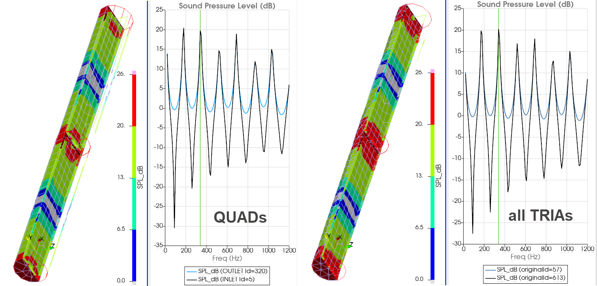

---

#### 3.1.5 CASE 5: [ VELO + IMPE ($Z = \rho c$) ] @ INLET & Rigid OUTLET

- **Boundary Conditions:**
  - **Inlet:** Normal Velocity ($v_n = 5\times 10^{-5}\text{ mm/s}$) + characteristic Impedance ($v_n + Z_0$)
  - **Outlet:** Rigid Boundary (Default: $v_n = 0\text{ mm/s}$)

- **Acoustic Behaviour:** Classic quarter-wave resonator: open one end (VELO + IMPE) & closed the other end. Resonant peaks occur at odd harmonics:

$$f_n = \frac{(2n - 1) c}{4L} = 85.75, 257.25, 428.75, 600.25\dots \text{ Hz}$$

> **SWL (dB)**: automatic power outputs in pyBEM

Note how frequency peaks match hand calculation for a quarter-wave pipe.

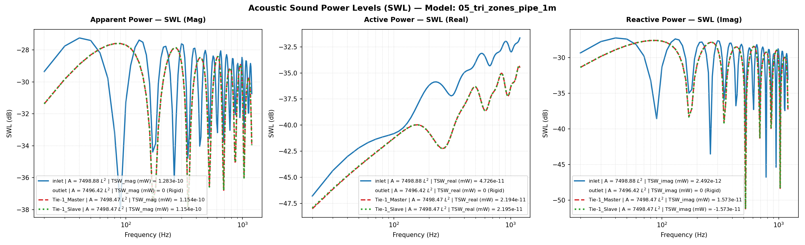

> **SPL (dB)**: Abaqus vs pyBEM

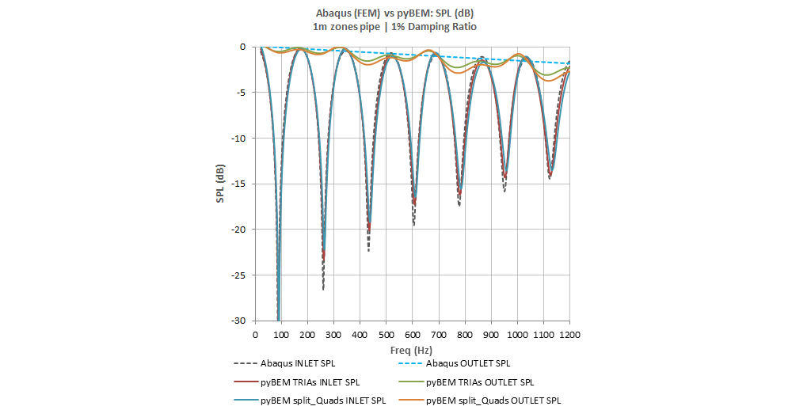

> **SPL (dB) Contours**: pyBEM results in ParaView

Figure shows SPL distribution at 260Hz.

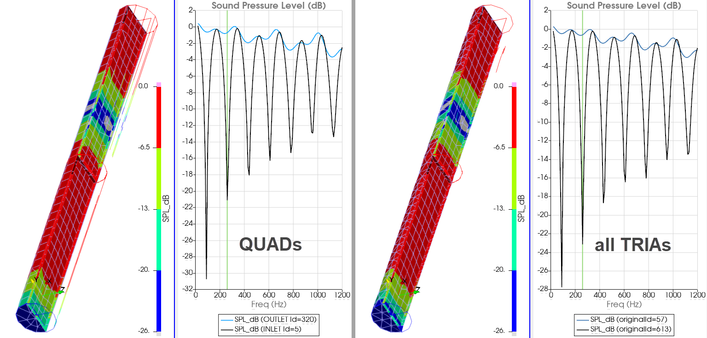

---

#### 3.1.6 CASE 6: VELO @ INLET & IMPE ($Z = \rho c$) @ OUTLET

- **Boundary Conditions:**
  - **Inlet:** Normal Velocity ($v_n = 5\times 10^{-5}\text{ mm/s}$) | Rigid piston
  - **Outlet:** Anechoic Impedance ($Z = \rho \cdot c$)

- **Acoustic Behaviour:** Velocity-driven pipe with non-reflecting anechoic termination at outlet. Acoustic energy exits without internal reflections, yielding a frequency response with no standing wave peaks.

> **SWL (dB)**: automatic power outputs in pyBEM

Note the wiggles in pyBEM are noise, as explained for CASE 3.

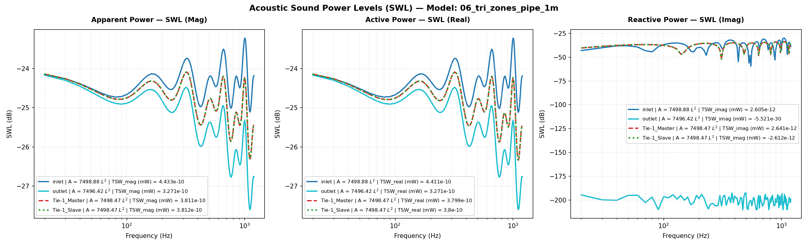

> **SPL (dB)**: Abaqus vs pyBEM

We can observe the effect mentioned above in the comparison: all TRIAs (higher DoF in matrix solve, less noisy) vs QUADs models.

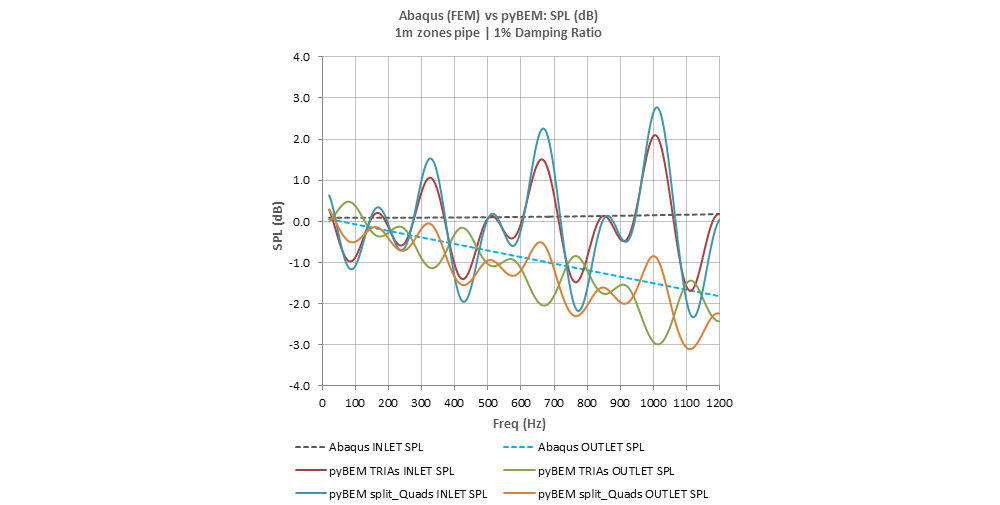

> **SPL (dB) Contours**: pyBEM results in ParaView

Figure shows SPL distribution at 1200Hz. Note the small scales range used for this specific case.

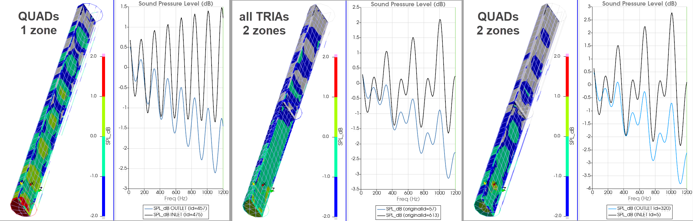

---

#### 3.1.7 `1m_pipe`: Comparison code_aster (FEM acoustics) vs pyBEM

At the time of implementing the multi-zone capability in pyBEM, as well as the Abaqus comparisons shown above, I also solved the pipe 6 cases in code_aster (FEM).

> **SPL (dB) Contours**: code_aster results in ParaView

Figure shows **code_aster** SPL (dB) distribution for the 6 cases presented above.

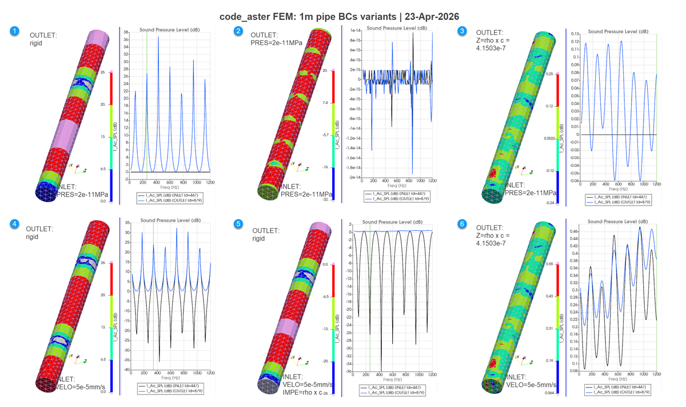

> **SPL (dB) Contours**: pyBEM results in ParaView

Figure shows **pyBEM** SPL (dB) distribution for the 6 cases presented above.

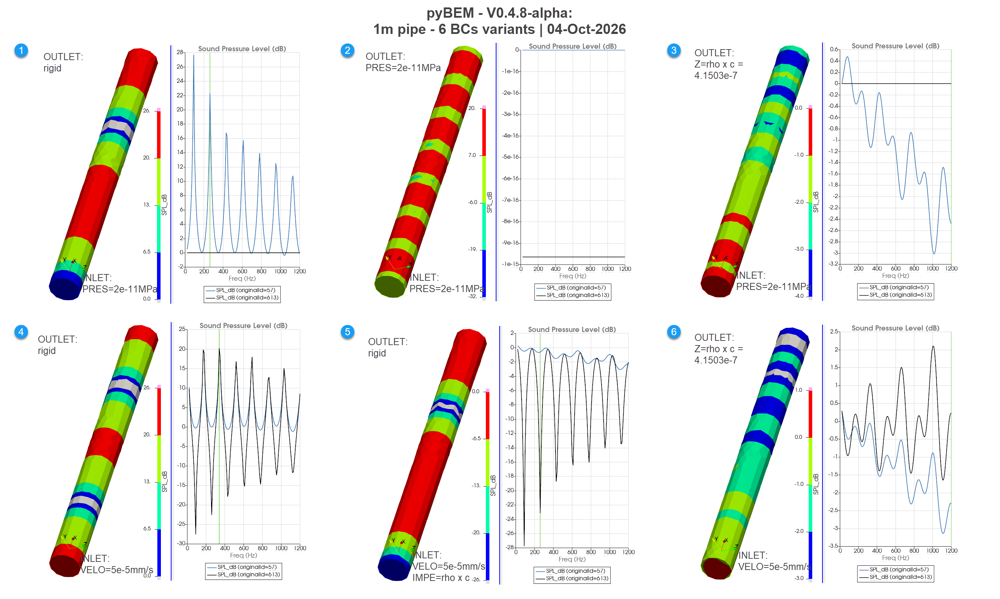

---

#### 3.1.8 `1m_pipe`: Preliminary Conclusions

- It is emphasised that trying to compare like-to-like across FEM vs BEM solvers with different meshes, damping and acoustic boundary conditions implementations; makes it hard to expect exactly the same results.

- Nevertheless, comparisons are still useful in terms of honouring basic principals for linear acoustics in pyBEM. Sensible similar trends are expected and hand calculations on resonant frequency values should be very close to predictions.

- Based on the results presented in this section for the 6 cases, we can conclude that pyBEM results are close to the Abaqus and code_aster results. They are all certainly *on the same bit of paper*.

- This is encouraging in terms of continuing with the multi-zone and TIED pairs capabilities, and with  further testing of pyBEM with more complex 3D geometries and setups.

---

### 3.2 `int_ext_boxes`: Simultaneous Interior & Exterior Acoustic Analysis

> [!NOTE]
> Small Multi-zone test model with two interior zones and one exterior one ; Damping Factor = 0%.\
> 7 spheres with MICS meshes capture the exterior radiation power for solver sanity checks (conservation of 'Active' energy).

Setting up an interior / exterior BEM model is relatively easy if we follow the main rules listed in [Section 1](#1-bem-meshing--modelling-rules). The normals on the last exterior zone are flipped to point inwards, so that the acoustics is solved in the infinite exterior domain. A TIED pair is then defined between interior zone 2 and the exterior zone 3.
\
***NOTE** that since we are not interested in the scattering at the back of the exterior zone, we make it short, which is enough to get the power outputs, while keeping solve times / RAM small.*

> **Interior & Exterior pyBEM Setup**: figure shows details of the meshes, ties and exterior MICS spheres as built in PrePoMax

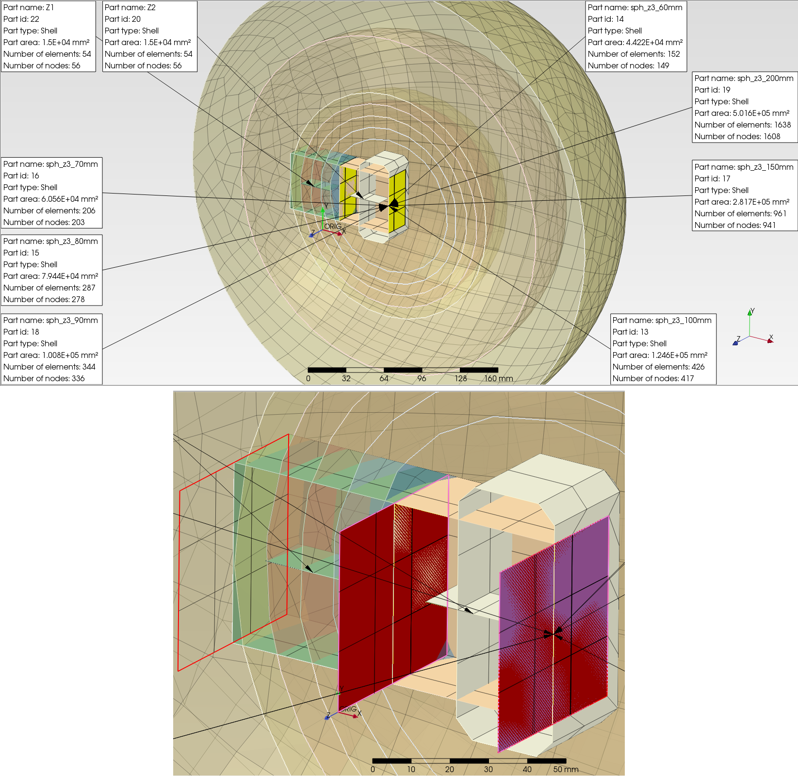

---

#### 3.2.1 Outlet Flange with Sharp (90deg) Corners

- **Boundary Conditions:**
  - **Inlet:** Normal Velocity ($v_n = 5\times 10^{-5}\text{ mm/s}$) | Rigid piston
  - **Outlet:** Interior : Exterior TIED pair constraint; i.e. BEM resolves the outlet Impedance at each frequency

- **Objectives:** Velocity-driven system with outlet geometry featuring a flange with sharp corners. This case illustrates potential numerical singularities to look out for with BEM methods.

> **PrePoMax mesh**: sharp outlet flange with 90deg corners

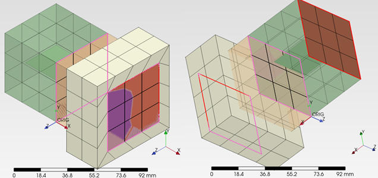

> **SWL (dB)**: automatic power outputs in pyBEM

We can observe two significant effects in power graphs:

- All **Active** (real part) SWL(dB) curves for the 7 exterior MICS spheres with different radius, lay on top of each other. This is expected when dissipation is not present, and shows the power calculations are sensible.
- The power curves for Tie-2 into the exterior blow up. This is due to potential numerical singularities at an outlet transition with a flange featuring sharp (90deg) corners near the outlet surface. The phase on the near-field velocities changes fast, without a smoother transition on the outlet geometry.

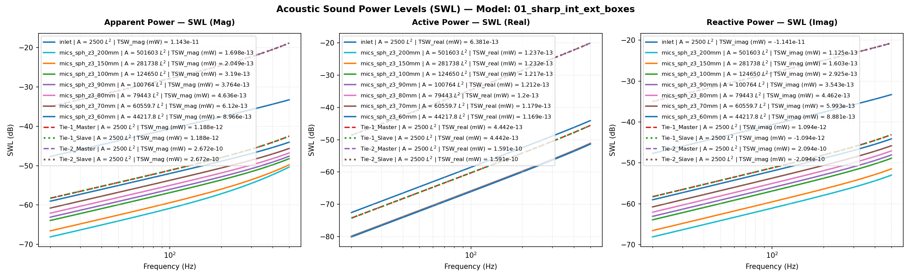

> **SPL (dB) Contours**: pyBEM Sound Pressure results in ParaView

Figure shows SPL distribution at 500Hz. The results look sensible in terms of transitioning from interior zones (high) into the exterior MICS spheres showing sensible SPL values decreasing with distance from the outlet.

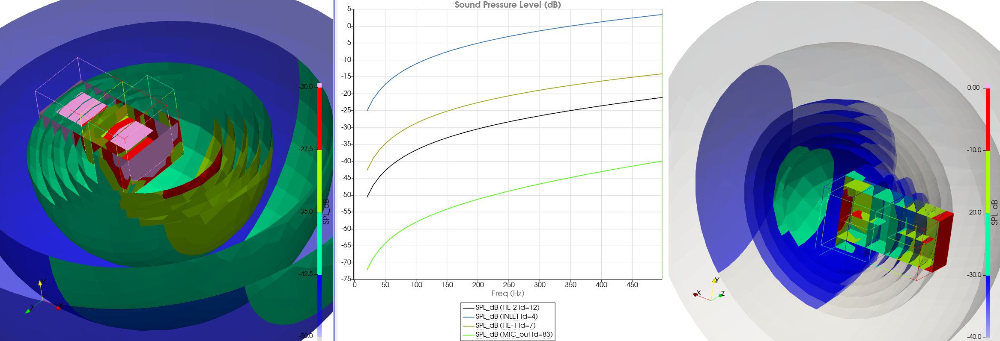

> [!WARNING]
> When modelling in BEM outlet geometries, comparative test work should be performed on each 3D geometry to assess potential numerical singularities in the near-field area.
---

#### 3.2.2 Chamfered Outlet (Smoother Corners)

- **Boundary Conditions:**
  - **Inlet:** Normal Velocity ($v_n = 5\times 10^{-5}\text{ mm/s}$) | Rigid piston
  - **Outlet:** Interior : Exterior TIED pair constraint; i.e. BEM resolves the outlet Impedance at each frequency

- **Objectives:** Effects from outlet geometry changes, featuring a chamfered flange. This case illustrates how to get around potential numerical singularities illustrated in the previous case.

> **PrePoMax mesh**: chamfered outlet flange

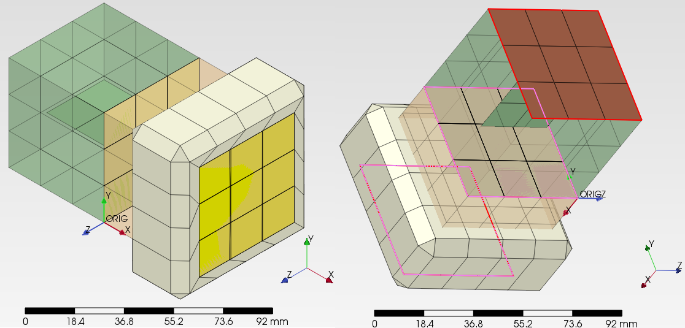

> **SWL (dB)**: automatic power outputs in pyBEM

While the **Active** (real part) SWL(dB) curves for the 7 exterior MICS spheres still maintain equal power, the blow up on power curves for Tie-2 has changed and reduced.

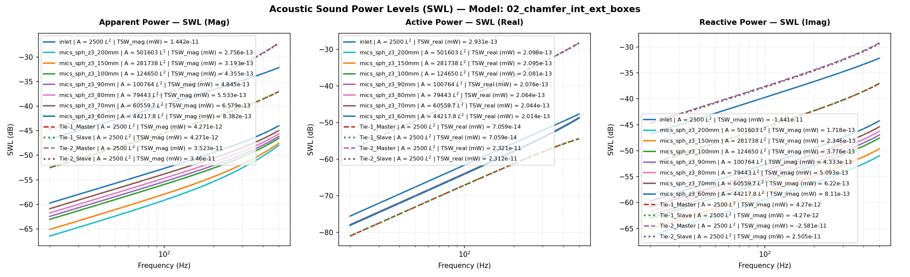

> **SPL (dB) Contours**: pyBEM Sound Pressure results in ParaView

Figure shows SPL distribution at 500Hz. The results look sensible in terms of transitioning from interior zones (high) into the exterior MICS spheres. Note how now we get a significantly smoother SPL distribution on the outlet tie-2 and flange vs the previous sharp corners model.

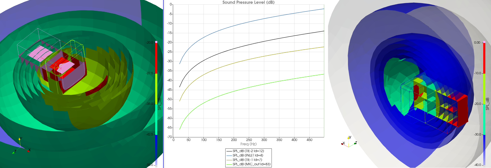

> [!NOTE]
> These very simple and coarse models are mainly for fast runs and methodology illustration in BEM. Absolute results presented are for trends and comparisons, and should be taken with a pinch of salt.

---

#### 3.2.3 All TRIAs, Chamfered Outlet

- **Boundary Conditions:**
  - **Inlet:** Normal Velocity ($v_n = 5\times 10^{-5}\text{ mm/s}$) | Rigid piston
  - **Outlet:** Interior : Exterior TIED pair constraint; i.e. BEM resolves the outlet Impedance at each frequency

- **Objectives:** All BEM zones re-meshed with TRIA elements. This is to illustrate the effect when doubling the number of DoF (element centroids) in a model, which affects accuracy in an element based collocation BEM solver. It also shows how the TIED constraint implementation handles many overlaps on pair surface mesh.

> **PrePoMax mesh**: all TRIAs, chamfered outlet flange

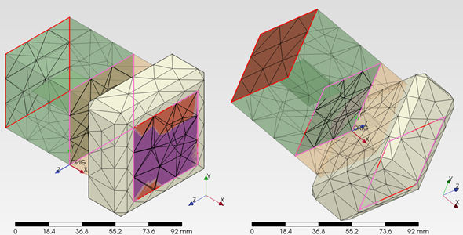

> **SWL (dB)**: automatic power outputs in pyBEM

In this case we can see the effects of increasing the DoF: the Tie-2 powers start getting closer to the other curves when compared to the (Quads) previous mesh.

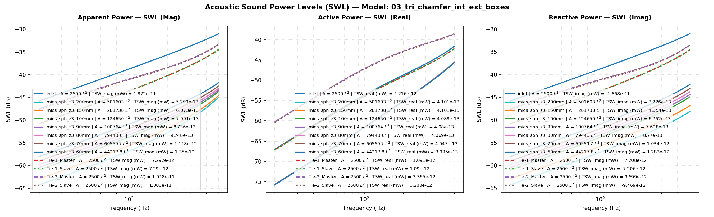

> **SPL (dB) Contours**: pyBEM Sound Pressure results in ParaView

Figure shows SPL distribution at 500Hz. The results show some smoother SPL distribution around the outlet (Tie-2). This agrees with expectations when increasing the number of DoF (elements) in BEM solvers.

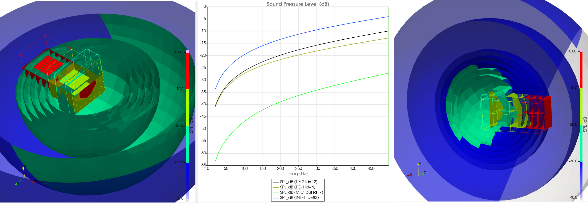

---

#### 3.2.4 `int_ext_boxes`: Preliminary Conclusions

- It is easy to model a **simultaneous interior / exterior** acoustics analysis in `pyBEM`, by simply adding an exterior zone with all BEM element normals pointing inwards, and a TIED pair with the last interior zone.
- We should keep an eye on potential **numerical singularities** at outlets with sharp corners. It is **recommended to chamfer or bellmouth** the outlet geometry, in order to improve the accuracy of the outlet conditions.
- Always first check the power plots on a new setup. **Conservation of energy** and input / output curves should make sense vs BCs and geometry analysed.

---

> [!TIP]
> Following the methodologies and template setups of the previous two small projects presented in *Sections 3.1 & 3.2*, we should be able to carry those methods over to really complex acoustic assemblies.

---
---

> [Back to MAIN page](../README.md)

---
